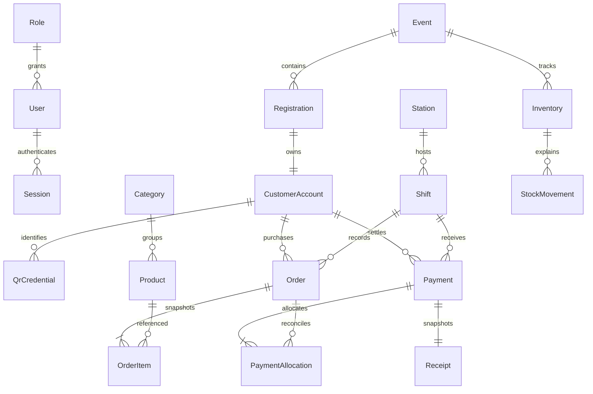

# Architecture

Next.js serves local assets and authenticated operational screens. Route handlers validate Origin, authenticate opaque HttpOnly sessions, validate Zod input, and call modular server services. Services enforce granular permissions again. Prisma uses PostgreSQL foreign keys, unique constraints, and serializable transactions with bounded retry. Audit writes commit with the operation. Only the central server persists financial transactions.

Money is integer satang. Customer QR contains only 256 bits of cryptographic randomness. QR credential reissue preserves the customer account and orders. Product, receipt and order snapshots preserve historical facts.

